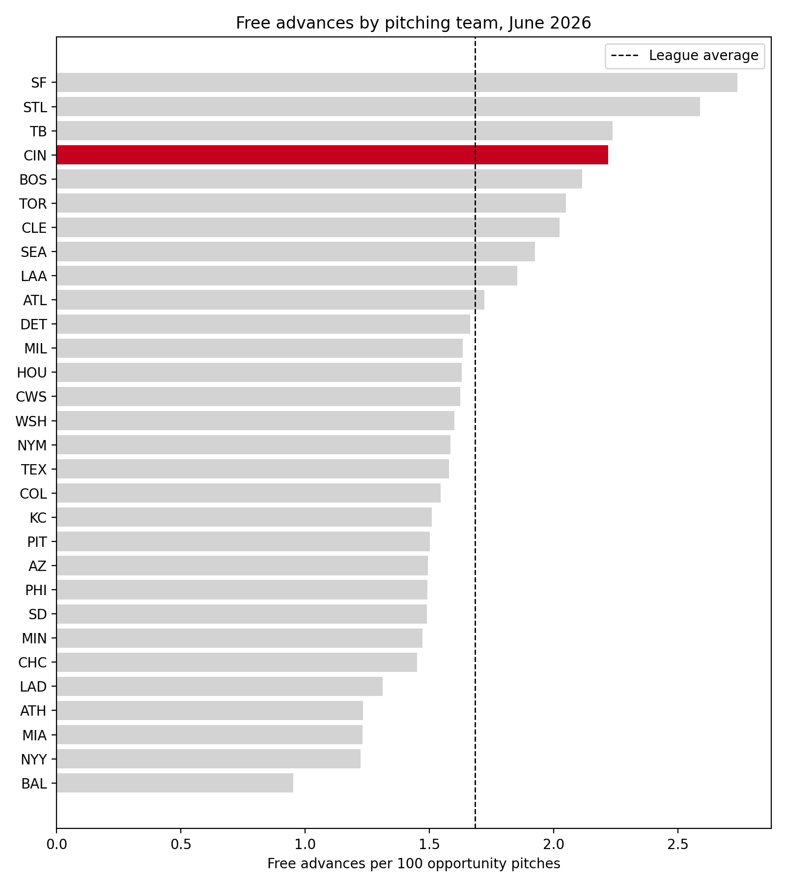

# Reds Running Game, 2026

I pulled every pitch the Reds threw in 2026 and counted the times a runner moved up a base without a hit. I call these free advances. There were 180, or 1.66 for every 100 pitches with a runner on first or second.

In June, the Reds' rate was 2.22 against a league average of 1.68. A 25% cut in free advances would be worth about 9 runs, or $7.7 million at market prices.

# To run it

# bash
pip install -r requirements.txt
python free_advances.py

The first run takes a few minutes while it downloads the data.

## Notes

This uses public data only, and the league comparison covers just June.